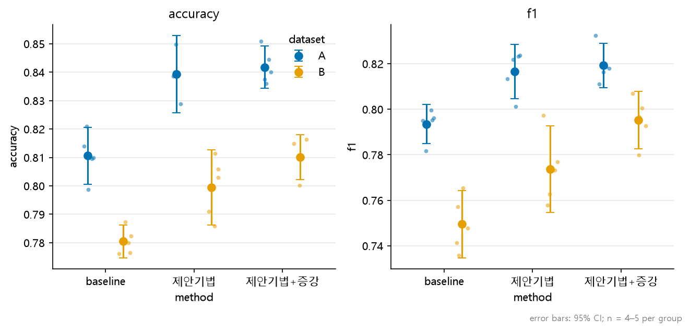
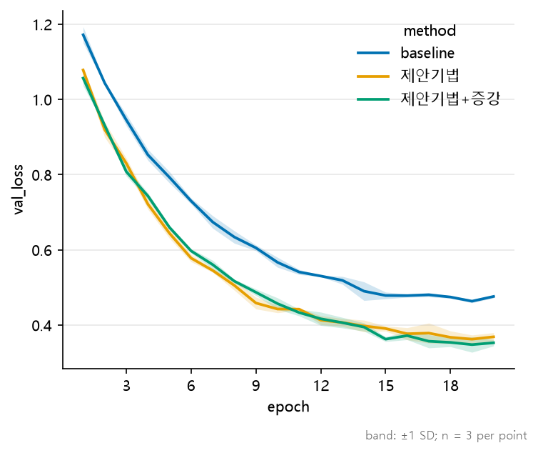

# research-skills

연구할 때 바로 쓰는 AI 에이전트 스킬 2개입니다. Claude Code를 비롯해 Agent Skills를 지원하는 에이전트에서 쓸 수 있습니다.

| 스킬 | 하는 일 | 이렇게 말하면 작동 |
|---|---|---|
| **citation-check** | 참고문헌이 실제로 있는 논문인지 무료 공개 DB(Crossref·OpenAlex·arXiv·DataCite)에서 확인합니다. 가짜 인용, 저자·연도 오류, 다른 논문을 가리키는 DOI를 찾고, 인용한 문장을 초록이 뒷받침하는지도 판정합니다. | "이 참고문헌 진짜 있는 논문인지 확인해줘", "제출 전에 .bib 검사해줘" |
| **experiment-report** | 실험 결과 CSV/엑셀을 요약 통계(평균, SD, 95% CI, Welch t-검정, Holm 보정, 효과크기), 그래프, 짧은 보고서로 정리합니다. 그래프는 AI가 직접 열어 보고 고친 뒤에 넘깁니다. | "실험 결과 정리해서 표랑 그래프 만들어줘", "baseline이랑 비교해줘" |

둘 다 **무료**입니다. 유료 API를 쓰지 않고, 스크립트는 Python 표준 라이브러리로 돌아갑니다(그래프만 matplotlib 필요).

## 설치

**Claude Code (플러그인 마켓플레이스)**

```
/plugin marketplace add gwangmin5882-cloud/research-skills
/plugin install research-skills@research-skills
```

**다른 에이전트 (Agent Skills CLI)**

```
npx skills add gwangmin5882-cloud/research-skills
```

**직접 복사**: `skills/` 안의 폴더를 `~/.claude/skills/`(개인용) 또는 프로젝트의 `.claude/skills/`에 복사합니다.

**필요한 것**: Python 3.8 이상. 그래프를 그리려면 `pip install matplotlib`, 엑셀 파일을 읽으려면 `pip install openpyxl`.

---

## citation-check: 인용 검증

AI가 만든 참고문헌에는 실제로 없는 논문이 섞입니다. 2025년 NeurIPS에서는 심사를 통과한 논문에서도 가짜 인용 100개가 발견됐습니다. 이 스킬은 두 단계로 확인합니다.

1. **존재 확인 (스크립트)**: 제목, 저자, 연도, DOI/arXiv 번호를 공개 DB와 대조합니다.
2. **주장 확인 (AI 판정)**: 인용한 문장을 해당 논문의 초록이 뒷받침하는지 봅니다. 판정은 초록에 적힌 내용만 근거로 하고, 근거 문구를 함께 보여 줍니다.

| 판정 | 뜻 |
|---|---|
| 확인됨 | 논문이 존재하고 서지 정보가 맞음 |
| 정보 일부 틀림 | 논문은 있지만 저자, 연도, 제목, DOI 중 일부가 틀림 |
| 식별자 불일치 | DOI나 arXiv 번호는 진짜지만 **다른 논문**을 가리킴 |
| 비슷한 논문만 있음 | 제목이 비슷한 다른 논문만 있음. 날조 가능성이 높음 |
| 찾을 수 없음 | DB에 없음. 날조 가능성이 높지만 책이나 학위논문일 수도 있음 |
| 확인 불가 | 비영문(국내) 문헌 등이라 해외 DB로는 확인할 수 없음 |
| 자리표시 문구 | "Firstname Lastname" 같은 템플릿 문구가 남아 있음 |

예제(`examples/citation-check/refs_sample.bib`, 일부러 틀리게 만든 항목 포함)를 넣으면 이렇게 판정됩니다.

| 항목 | 넣은 문제 | 판정 |
|---|---|---|
| Vaswani 2017, Walters 2023, He 2016, Rao 2026 | 없음 (진짜) | 확인됨 |
| BERT (첫 저자·연도 틀림) | 정보 오류 | 정보 일부 틀림 |
| LeCun "Deep learning"의 DOI에 다른 제목을 붙임 | 식별자 도용 | 식별자 불일치 |
| 지어낸 논문 2개 | 날조 | 찾을 수 없음 |
| "Title to be updated" | 템플릿 | 자리표시 문구 |
| 가상의 국내 논문 | 비영문 | 확인 불가 |

**직접 실행**

```bash
python skills/citation-check/scripts/check_refs.py refs.bib --abstracts --out citation_check
```

`.bib`, 한 줄에 하나씩 쓴 텍스트(APA·IEEE 등 어떤 양식이든), JSON을 읽습니다. 결과는 `citation_report.md`와 `citation_report.json`으로 저장됩니다.

**개인정보**: 외부로 보내는 것은 참고문헌의 제목, 저자, 연도, 식별자뿐입니다. 원고 본문은 보내지 않습니다.

## experiment-report: 실험 결과 정리



- **숫자는 전부 스크립트가 계산합니다.** 보고서에 들어가는 모든 숫자는 `summary.json`에서 가져옵니다. 손으로 옮기다 생기는 오류를 막기 위해서입니다.
- **그래프는 AI가 직접 보고 고칩니다.** 한글 깨짐, 라벨 겹침, 범례 가림, 차이를 숨기는 막대그래프 등을 확인한 뒤에 넘깁니다.
- **정직한 통계**를 씁니다. 다중비교에는 Holm 보정을 하고, 효과크기(Cohen's d)와 n이 작을 때의 경고를 함께 적습니다. 이상치(Grubbs 검정)는 조용히 지우지 않고 보고합니다.
- 한국어 엑셀 CSV(CP949)와 한글 라벨(맑은 고딕, 애플고딕, 나눔고딕, Noto Sans KR 자동 선택)을 지원합니다.

**직접 실행**

```bash
python skills/experiment-report/scripts/summarize.py results.csv --group method --compare baseline
python skills/experiment-report/scripts/plot.py results.csv --kind point --x method --y accuracy --hue dataset --out figs/accuracy.png
python skills/experiment-report/scripts/plot.py log.csv --kind line --x epoch --y val_loss --hue method
```



---

## 스킬이 있을 때와 없을 때 비교

같은 모델(Claude Opus 5)과 같은 Python 가상환경에서 같은 과제를 조건마다 3번씩 돌렸습니다. 두 조건의 차이는 스킬을 불러왔는지 하나뿐입니다. 자세한 방법과 결과는 [`benchmark/`](benchmark/README.md)에 있습니다.

| 과제 | 스킬 없음 | 스킬 있음 |
|---|---|---|
| 인용 검증 (10개 참고문헌 중 가짜·오류 찾기) | 3회 모두 만점, 107초 | 3회 모두 만점, 120초 |
| 실험 결과 정리 (14개 항목 블라인드 채점) | 12·12·13점, 402초 | 14·13·14점, 199초 |

- 인용 검증은 웹 검색이 되는 최신 모델이라면 스킬 없이도 다 맞혔습니다.
- 실험 정리에서 생긴 차이는 대부분 그림이었습니다. 스킬 없이 만든 보고서 3건은 모두 라벨이 데이터나 다른 라벨과 겹쳤고, 스킬을 쓴 3건은 하나도 겹치지 않았습니다. 시간과 출력 토큰도 절반 수준이었습니다.
- 조건당 3회, 모델 1개, AI 채점자 1명으로 한 작은 실험이라, 정밀한 측정이라기보다 시연에 가깝습니다.

## 한계

- citation-check: 책, 학위논문, 국내 학술지, 나온 지 얼마 안 된 논문은 DB에 없을 수 있어서 "찾을 수 없음"이 곧 가짜라는 뜻은 아닙니다. 주장 판정은 초록만 보기 때문에, 확신이 없으면 "판단 불가"로 둡니다. OpenAlex 키워드 검색은 API 키가 없으면 제한되므로 `OPENALEX_API_KEY` 환경변수를 설정하면 더 많이 찾습니다.
- experiment-report: 독립 표본 비교(Welch t-검정)만 제공합니다. 대응 표본, 비모수 검정, 혼합모형 등이 필요하면 별도 분석이 필요합니다.

## 근거 자료

- Ansari (2026), [Failure mode taxonomy of 100 fabricated citations at NeurIPS 2025](https://arxiv.org/abs/2602.05930)
- Russinovich et al. (2026), [Phantom References](https://arxiv.org/abs/2607.00738)
- Rao et al. (2026), [Reference hallucinations in commercial LLMs and deep research agents](https://arxiv.org/abs/2604.03173)
- Walters & Wilder (2023), [Fabrication and errors in the bibliographic citations generated by ChatGPT](https://doi.org/10.1038/s41598-023-41032-5)
- Badalova & Mayr (2026), [Detecting hallucinated and suspicious citations: what current tools can and cannot do](https://arxiv.org/abs/2607.22693)

## English

Two free agent skills for research:

- **citation-check** verifies that references exist via Crossref, OpenAlex, arXiv and DataCite. It flags fabricated entries, wrong metadata, DOIs that point to a different paper, and placeholders, then judges from abstracts whether each source supports the sentence citing it. Use `--lang en` for English reports.
- **experiment-report** turns result CSV/XLSX files into descriptive statistics, Welch's t-tests with Holm correction and effect sizes, publication-style figures that the agent visually checks and fixes, and a short report where every number comes from the computed summary.

Install with `/plugin marketplace add gwangmin5882-cloud/research-skills` (Claude Code) or `npx skills add gwangmin5882-cloud/research-skills`. Requires Python 3.8+, plus matplotlib for figures.

[`benchmark/`](benchmark/README.md) compares the same agent with and without the skills in one shared Python environment (3 runs each). Citation checking: no difference, since all runs scored 1.00. Experiment reports: 0.98 with the skill vs 0.88 without, mostly because of figure readability, in half the time.

## License

MIT
