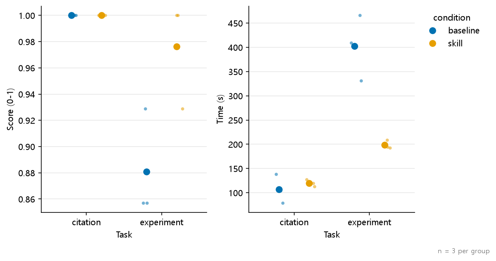

# Benchmark: with skill vs without skill

This benchmark asks whether installing these skills actually changes the result. The same AI agent (headless Claude Code, same model) gets the same task twice. The only difference is whether the skills are loaded.

## What is held constant

| | Both conditions |
|---|---|
| Python | One shared virtual environment (`.venv`) with pinned packages (`requirements.lock.txt`), first on `PATH`. Before any run, a preflight check makes sure matplotlib can draw and save a figure from that venv; if it can't, nothing starts. Before every pair of runs, the venv is put back to exactly the lock file (agents sometimes `pip install` things), and each run's `meta.json` records any difference left at its end |
| Agent | `claude -p` (headless Claude Code), same model, same allowed tools (`Bash Read Write Edit Glob Grep WebFetch WebSearch Skill`) |
| Task | Same prompt (`tasks/*/prompt.md`) and same input files, copied into a fresh folder for every run |
| Timing | For each repetition, both conditions run at the same time, so public APIs (Crossref, arXiv, …) treat them alike |
| **Difference** | `skill` runs with `--plugin-dir <this repo>`; `baseline` runs without it |

## Tasks

**citation**: `tasks/citation/input/manuscript.md`, a Korean introduction with 10 references. These inputs were never used while building the skill. The references are 5 real papers, 1 real paper with a wrong year, 2 with a DOI or arXiv ID that points to a different paper, and 2 invented papers. Two citing sentences misstate their source. The agent must write `verdicts.csv`, and `grade.py citation` scores it against `answer_key.json`.

**experiment**: `tasks/experiment/input/`. It holds results for 3 methods × 2 datasets × 5 seeds in a CP949-encoded CSV with Korean headers, as Korean Excel saves it, plus a training log. Planted traps:
- a crashed run (accuracy 0.10) that makes one method look worse
- a missing value
- one comparison with no real difference
- a baseline that overfits after epoch 17

A reviewer who doesn't know which condition produced each report scores it on 14 items (`rubric.md`). `make_data.py` regenerates the data and the answer key.

## Reproduce

```bash
cd benchmark
./setup_env.sh            # or .\setup_env.ps1 on Windows
claude auth login         # headless Claude Code uses your Claude account
.venv/bin/python run_benchmark.py --reps 3          # Windows: .venv\Scripts\python run_benchmark.py --reps 3
.venv/bin/python grade.py citation
.venv/bin/python grade.py blind                     # then grade grading/R* with rubric.md -> grading/grades.json
.venv/bin/python grade.py aggregate                 # results/results.md
```

Each run takes a few minutes and uses your Claude plan's usage. Raw runs (transcripts, outputs) go to `runs/`, which is not committed. `results/` holds the summary.

**Windows: keep the venv on a short path.** Windows can't load a DLL whose full path is longer than 260 characters, and Pillow (which matplotlib needs) ships one deep inside the venv. If this repository sits in a deep folder, set `BENCH_HOME` to a short folder first. The venv, `runs/` and `grading/` then go there, and `results/` stays here:

```powershell
$env:BENCH_HOME = "C:\Users\you\rsb"
.\setup_env.ps1
C:\Users\you\rsb\.venv\Scripts\python run_benchmark.py --reps 3
```

## Notes on this run

- Model: `claude-opus-5` for both conditions, via Claude Code CLI 2.1.278 on Windows 11 with Python 3.14.7. Opus 5.5 needs CLI ≥ 2.1.280; to use it, run `claude update` and pass `--model claude-opus-5-5`.
- The first attempt was discarded. Its venv path was 209 characters long, which put Pillow's DLL at 260 characters, so in all 12 runs matplotlib failed to import. Each agent worked around it differently: most linked a short path to the same venv, but one baseline run built a second venv elsewhere. The runs therefore did not share one environment, and the workarounds added time and turns. The results below come from a rerun with the venv in a short folder (set with `BENCH_HOME`; venv path 21 characters) and the preflight check passing. For the record, the first attempt scored: citation 1.00 vs 1.00; experiment 0.90 ± 0.04 (baseline) vs 1.00 ± 0.00 (skill), all baseline deductions on figures.
- One deviation in the rerun: the baseline agent in experiment repetition 1 ran `pip install scipy` in the shared venv, and scipy stayed there for repetitions 2 and 3. Both runs of each pair still started from the same venv. The skill runs never used scipy, while baseline runs 2 and 3 did, so if anything this helped the baseline. The restore-to-lock step above was added after this run to prevent it.
- Answer key change after the pilot: reference [3] (an invented title carrying the real DOI of another paper) fits both `WRONG_ID` and `FAKE` as the prompt defines them, so both are accepted. The change applies to both conditions equally.
- Blinding is partial. The grader did not know which condition produced which report, but figure styles and file names can hint at it.

## Results

3 runs per condition, `claude-opus-5`, 2026-11-25. Full table: [`results/results.md`](results/results.md); per-run numbers: [`results/runs.csv`](results/runs.csv); the grader's item-by-item evidence: [`results/grading/`](results/grading/).

| Task | Condition | Score | Time (s) | Turns | Output tokens |
|---|---|---|---|---|---|
| citation | without skill | 1.00, 1.00, 1.00 | 107 ± 30 | 20 | 7,329 |
| citation | with skill | 1.00, 1.00, 1.00 | 120 ± 7 | 15 | 6,969 |
| experiment | without skill | 12, 12, 13 of 14 (0.88) | 402 ± 67 | 46 | 30,870 |
| experiment | with skill | 14, 13, 14 of 14 (0.98) | 199 ± 9 | 30 | 15,978 |



Large dots are means; small dots are single runs. The score axis does not start at 0.

What the numbers say:
- **Citation:** no difference in accuracy. With web search, Opus 5 found every fake and every wrong ID on its own, with or without the skill. The skill made run time steadier (SD 7 s vs 30 s) but not shorter.
- **Experiment:** every report found the crashed run, the missing value, the no-difference comparison and the overfitting. The difference is elsewhere:
  - *Figures (item 13):* all 3 runs without the skill drew labels over data or over other labels; none with the skill did. The skill's workflow makes the agent open every PNG and fix what it sees.
  - *Numbers (item 11):* 2 runs without the skill and 1 with it wrote the same wrong sentence: "every method is about 3–4 points lower on 데이터2". 제안A is actually 6.4 points lower. The skill computes the tables, but this sentence was the agent's own summary, so the skill doesn't prevent that kind of error.
  - *Effort:* with the skill, runs took half the time (199 vs 402 s), two thirds of the turns and half the output tokens.

Limits: 3 runs per condition, one model, one task per skill, and one AI grader. The grader didn't know the conditions, but figure styles may hint at them. Treat these results as a demonstration, not a measurement.
